<h3><code>panda@github ~ $ ./contributions.sh</code></h3>

  

<h3><code>panda@github ~ $ whoami</code></h3>

<table>
  <tr>
    <td valign="top"></td>
    <td valign="top"></td>
  </tr>
</table>

 

<h3><code>panda@github ~ $ ls ~/projects</code></h3>

<table>
  <tr>
    <td><a href="https://github.com/Ndiku-leonald/borrow_mate"><code>borrow_mate/</code></a></td>
    <td>Location-based peer-to-peer borrowing for students in hostels</td>
    <td><code>Python</code></td>
  </tr>
  <tr>
    <td><a href="https://github.com/Ndiku-leonald/crafthub-project"><code>crafthub-project/</code></a></td>
    <td>Skills, marketplace and baby-health guidance for mothers and caregivers</td>
    <td><code>JS · TS</code></td>
  </tr>
  <tr>
    <td><a href="https://github.com/Ndiku-leonald/school-report-system"><code>school-report-system/</code></a></td>
    <td>School reporting system backed by PostgreSQL</td>
    <td><code>TS · SQL</code></td>
  </tr>
  <tr>
    <td><a href="https://github.com/Ndiku-leonald/web-app-101"><code>web-app-101/</code></a></td>
    <td>UCU Innovators Hub — students submit projects, supervisors review and grade</td>
    <td><code>JS</code></td>
  </tr>
  <tr>
    <td><a href="https://github.com/Ndiku-leonald/JWT_MIDDLEWARE"><code>JWT_MIDDLEWARE/</code></a></td>
    <td>JSON Web Token auth with five endpoints</td>
    <td><code>Node.js</code></td>
  </tr>
  <tr>
    <td><a href="https://github.com/Ndiku-leonald/OOP-WORK"><code>OOP-WORK/</code></a></td>
    <td>Python OOP examples for UCU, told through Ugandan stories</td>
    <td><code>Python</code></td>
  </tr>
</table>

 

<code>heatmap refreshes daily via GitHub Actions · all animation lives inside the SVGs</code>

